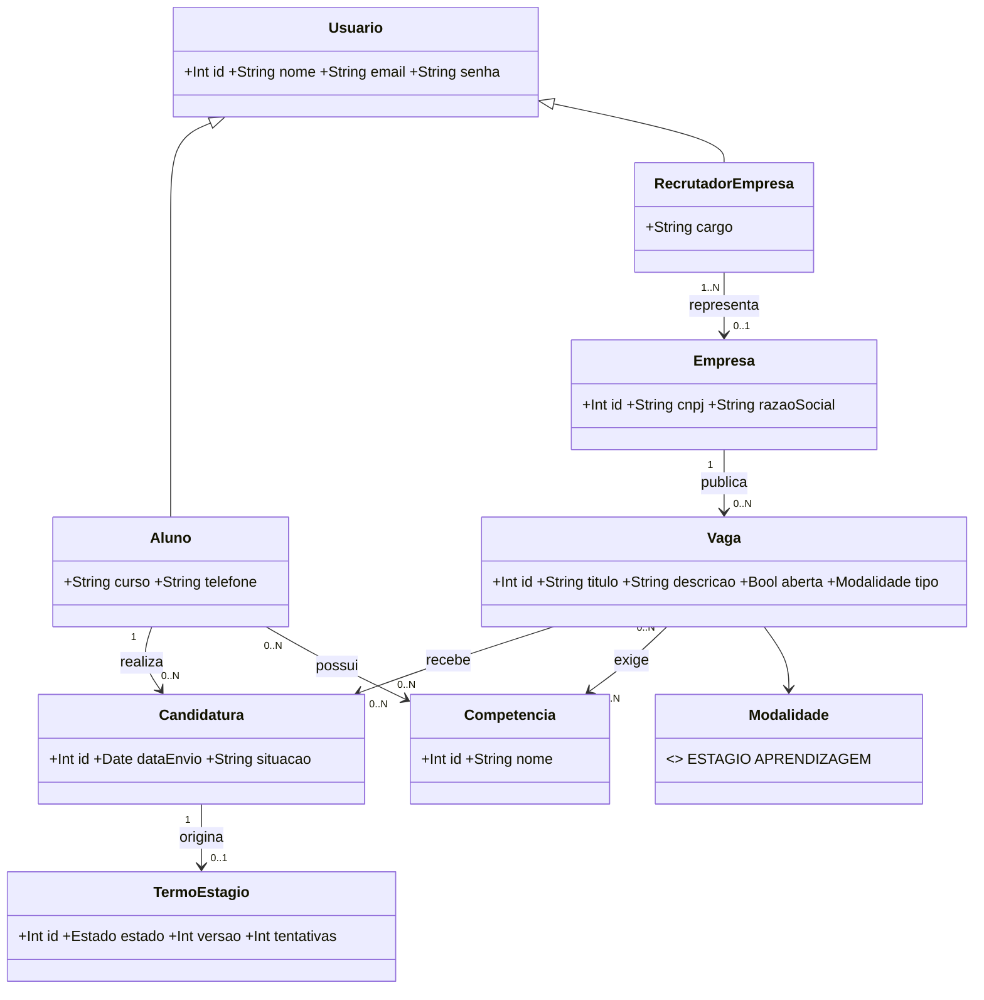
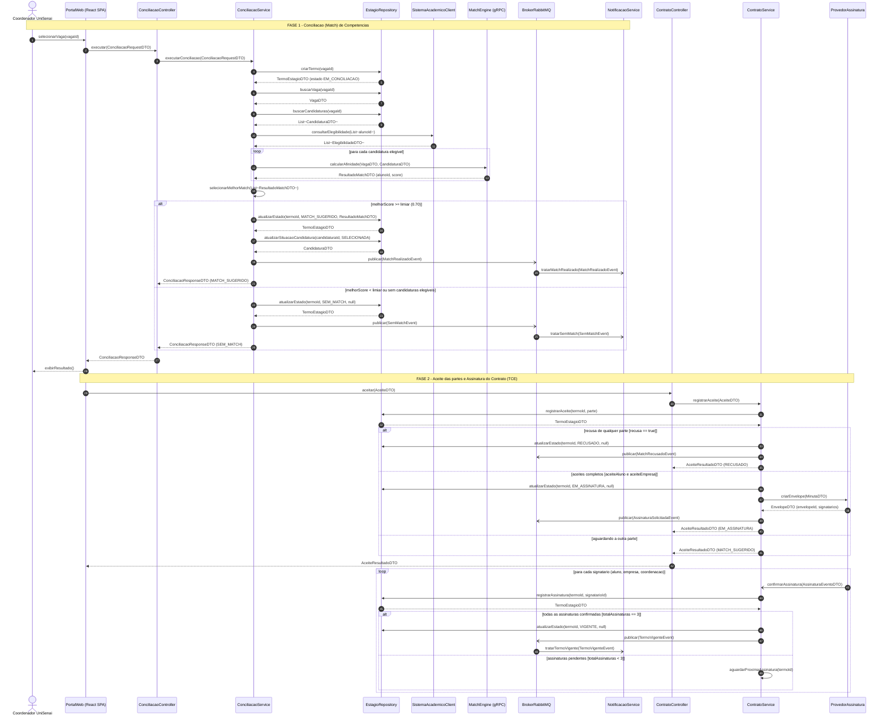
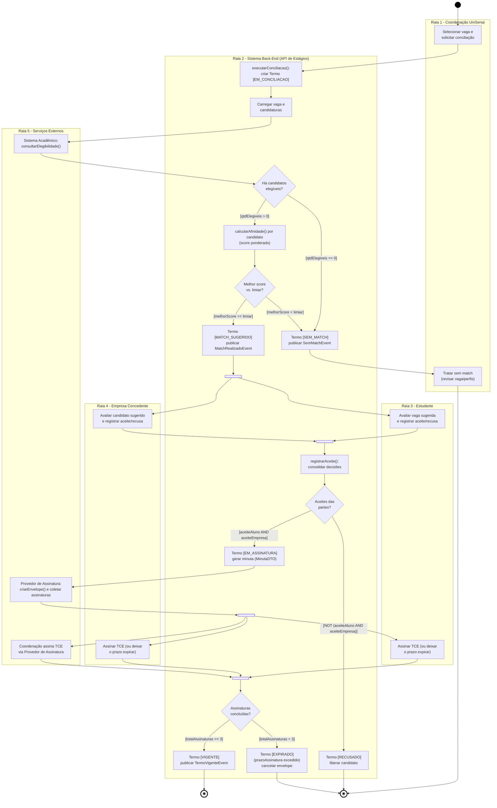
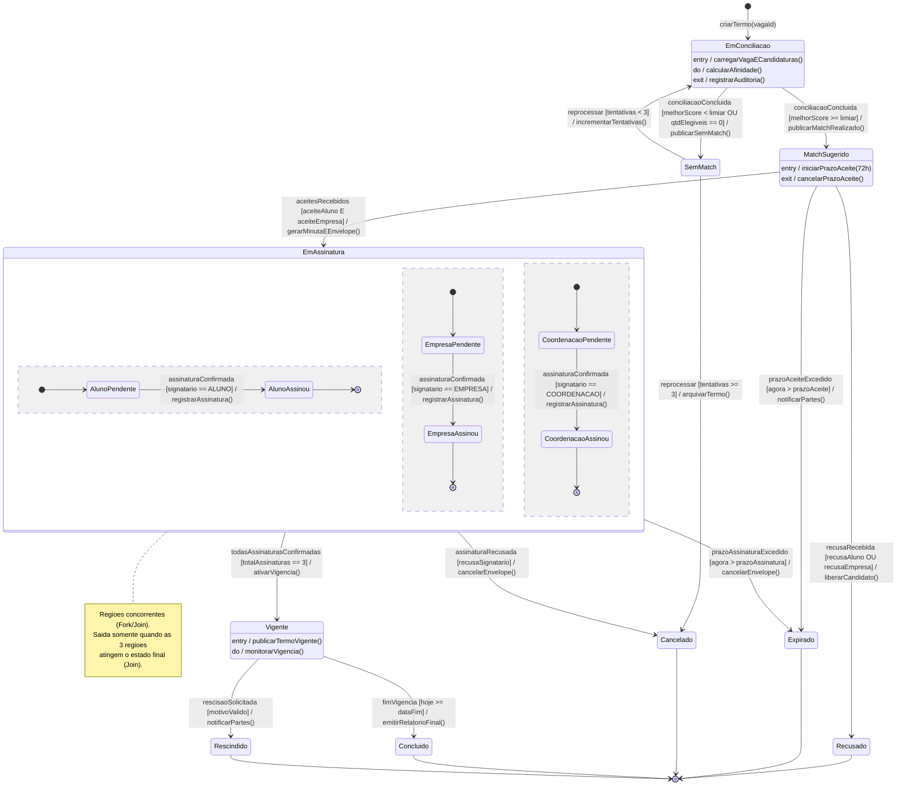
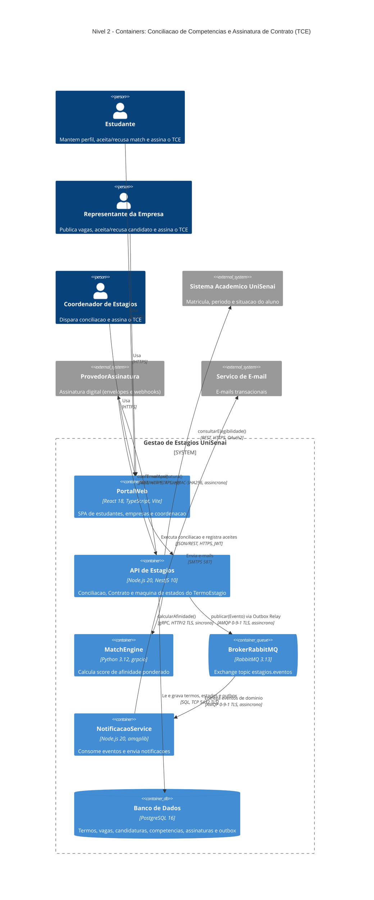

# APS 2 — Dossiê de Arquitetura Viva: Gestão de Estágios UniSenai

**Funcionalidade crítica:** Algoritmo de Conciliação (Match) de Competências e Assinatura de Contrato (TCE)
**Autor(a):** Nome Sobrenome — *(substitua pelo seu nome)*
**Entidade de domínio principal:** `TermoEstagio`

## 1. Explicação da funcionalidade

O coordenador de estágios seleciona uma vaga publicada por uma empresa concedente e dispara a **conciliação**. O sistema:

1. Cria um `TermoEstagio` (estado `EM_CONCILIACAO`) e carrega a vaga e as **candidaturas** registradas pelos alunos.
2. Consulta o Sistema Acadêmico para filtrar alunos **elegíveis** (matrícula ativa, período mínimo, sem estágio vigente).
3. Para cada candidato elegível, o **MatchEngine** (gRPC) calcula o score de afinidade:
   `score = 0,60 × cobertura(competências obrigatórias) + 0,25 × cobertura(desejáveis, ponderada por nível) + 0,15 × aderência(curso/período)`.
4. Se `melhorScore >= 0,70` o termo vai a `MATCH_SUGERIDO`; caso contrário, a `SEM_MATCH`.
5. Aluno e empresa decidem **em paralelo** (Fork/Join). Com os dois aceites, o termo passa a `EM_ASSINATURA` e a minuta é enviada ao Provedor de Assinatura.
6. Aluno, empresa e coordenação assinam **em paralelo**. Com `totalAssinaturas == 3`, o termo fica `VIGENTE` e o evento `TermoVigenteEvent` é publicado.

**Proteção contra estados inválidos:** transições só ocorrem pelo método de domínio do `TermoEstagio`, que valida o estado de origem e a guarda; há *optimistic locking* (coluna `versao`) e webhooks idempotentes (`envelopeId + signatarioId`).

## 1.1 Modelo de domínio (base da equipe)

A funcionalidade usa as classes do diagrama de classes inicial da equipe e acrescenta `TermoEstagio`, que nasce de uma `Candidatura` selecionada. A conciliação compara `Vaga.competenciasExigidas` com `Aluno.competencias`; ao sugerir o match, a `Candidatura.situacao` passa a `SELECIONADA`.

## 2. Artefato 1 — Diagrama de Sequência

Arquivo: [`docs/diagrams/sequencia.mmd`](docs/diagrams/sequencia.mmd). Chamadas síncronas usam `->>`, assíncronas/mensageria usam `-)`, e os retornos com DTOs usam `-->>`.

### Contratos de interface (regra de consistência)

Toda mensagem recebida por uma linha de vida corresponde a uma operação pública abaixo.

| Linha de vida | Operações públicas | Retorno (DTO) |
|---|---|---|
| `ConciliacaoController` | `executar(ConciliacaoRequestDTO)` | `ConciliacaoResponseDTO` |
| `ConciliacaoService` | `executarConciliacao(ConciliacaoRequestDTO)` `selecionarMelhorMatch(List<ResultadoMatchDTO>)` | `ConciliacaoResponseDTO` `ResultadoMatchDTO` |
| `EstagioRepository` | `criarTermo(vagaId)` `buscarVaga(vagaId)` `buscarCandidaturas(vagaId)` `atualizarEstado(termoId, estado, ResultadoMatchDTO)` `registrarAceite(termoId, parte)` `registrarAssinatura(termoId, signatarioId)` `atualizarSituacaoCandidatura(candidaturaId, situacao)` | `TermoEstagioDTO` `VagaDTO` `List<CandidaturaDTO>` `TermoEstagioDTO` ×3 `CandidaturaDTO` |
| `SistemaAcademicoClient` | `consultarElegibilidade(List<alunoId>)` | `List<ElegibilidadeDTO>` |
| `MatchEngine` (gRPC) | `calcularAfinidade(VagaDTO, CandidaturaDTO)` | `ResultadoMatchDTO` |
| `BrokerRabbitMQ` | `publicar(Evento)` | — (assíncrono) |
| `NotificacaoService` | `tratarMatchRealizado(MatchRealizadoEvent)` `tratarSemMatch(SemMatchEvent)` `tratarTermoVigente(TermoVigenteEvent)` | — (assíncrono) |
| `ContratoController` | `aceitar(AceiteDTO)` | `AceiteResultadoDTO` |
| `ContratoService` | `registrarAceite(AceiteDTO)` `confirmarAssinatura(AssinaturaEventoDTO)` `aguardarProximaAssinatura(termoId)` | `AceiteResultadoDTO` — (webhook assíncrono) — |
| `ProvedorAssinatura` | `criarEnvelope(MinutaDTO)` | `EnvelopeDTO` |
| `PortalWeb` | `selecionarVaga(vagaId)`, `exibirResultado()` | — |

## 3. Artefato 2 — Diagrama de Atividades com Raias

Arquivo: [`docs/diagrams/atividades.mmd`](docs/diagrams/atividades.mmd). Cinco raias, quatro decisões com guardas mutuamente exclusivas e dois pares Fork/Join (aceites paralelos e assinaturas paralelas).

## 4. Artefato 3 — Diagrama de Transição de Estados

Arquivo: [`docs/diagrams/estados.mmd`](docs/diagrams/estados.mmd). Transições no formato `Gatilho [Guarda] / Ação()`, ações internas `entry/do/exit`, região composta concorrente `EmAssinatura` e cinco estados terminais.

## 5. Artefato 4 — Visão C4 (Nível 2, Contêineres)

Arquivos: [`docs/architecture/workspace.dsl`](docs/architecture/workspace.dsl) (C4-PlantUML) e [`docs/architecture/c4-containers.mmd`](docs/architecture/c4-containers.mmd) (versão Mermaid renderizada abaixo).

## 6. Artefato 5 — ADR 0001

Texto completo em [`docs/architecture/adr-0001.md`](docs/architecture/adr-0001.md).

**ADR 0001 — Mensageria Assíncrona com RabbitMQ e Transactional Outbox** · **Status:** Aprovado
**Contexto:** a conciliação integra Sistema Acadêmico, provedor de assinatura (webhooks) e e-mail; gravar o estado e publicar o evento separadamente gera inconsistência.
**Decisão:** RabbitMQ 3.13 com padrão Transactional Outbox em PostgreSQL 16; matching permanece síncrono (gRPC).
**Consequências:** desacoplamento e eventos sem perda; em troca, consistência eventual, consumidores idempotentes e operação do broker.

## 7. Rastreabilidade entre modelos

| Estado (Artefato 3) | Atividade (Artefato 2) | Mensagem (Artefato 1) |
|---|---|---|
| `EmConciliacao` | `executarConciliacao()`, `calcularAfinidade()` | `executarConciliacao`, `calcularAfinidade` |
| `MatchSugerido` | Termo `[MATCH_SUGERIDO]` + Fork 1 (aceites) | `atualizarEstado(MATCH_SUGERIDO)`, `registrarAceite` |
| `SemMatch` | Termo `[SEM_MATCH]` | `atualizarEstado(SEM_MATCH)`, `publicar(SemMatchEvent)` |
| `EmAssinatura` | Fork 2 (3 assinaturas) | `criarEnvelope`, `confirmarAssinatura` ×3 |
| `Vigente` | Termo `[VIGENTE]` | `atualizarEstado(VIGENTE)`, `publicar(TermoVigenteEvent)` |
| `Recusado` / `Expirado` / `Cancelado` | Termo `[RECUSADO]` / `[EXPIRADO]` | `atualizarEstado(RECUSADO)`, `publicar(MatchRecusadoEvent)` |

## 8. Como renderizar

- GitHub e GitLab renderizam os blocos `mermaid` deste README.
- PlantUML (`workspace.dsl`): `java -jar plantuml.jar docs/architecture/workspace.dsl`.
- Mermaid CLI: `npx -p @mermaid-js/mermaid-cli mmdc -i docs/diagrams/sequencia.mmd -o sequencia.svg`.
